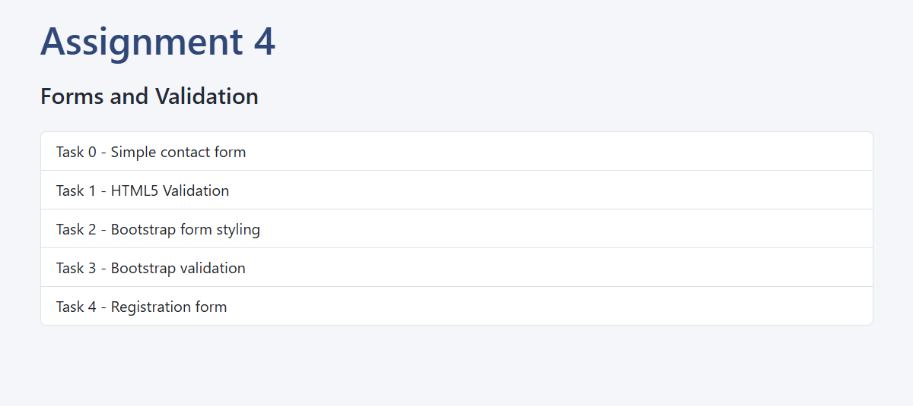
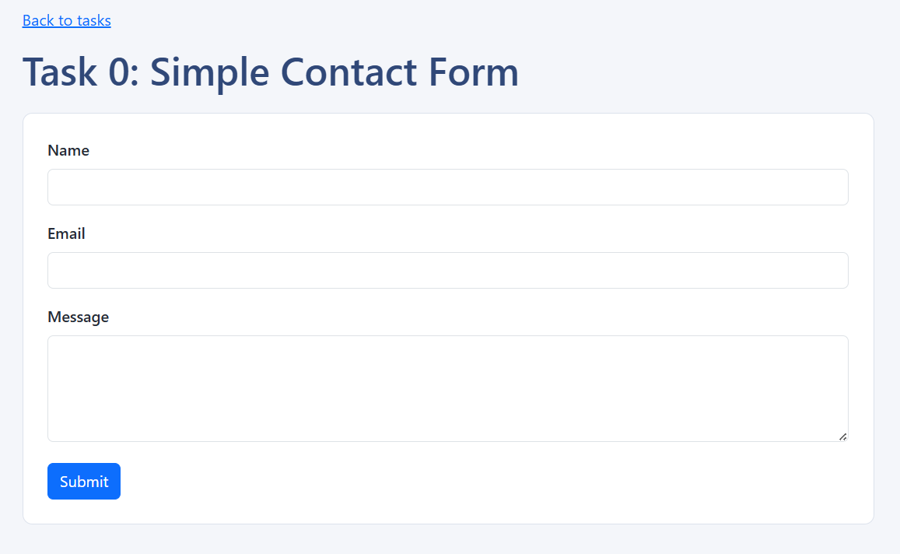
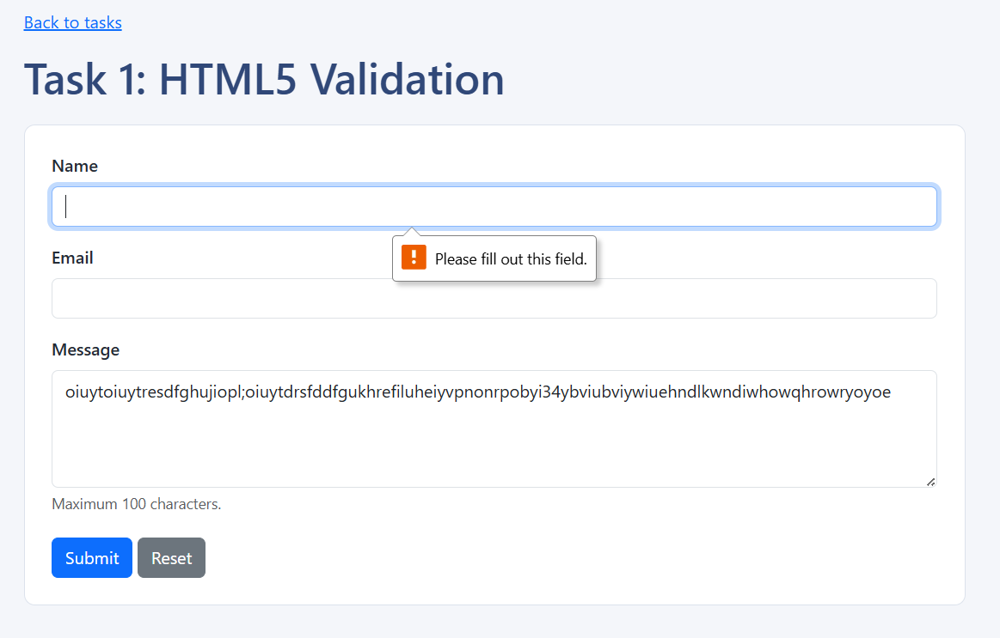
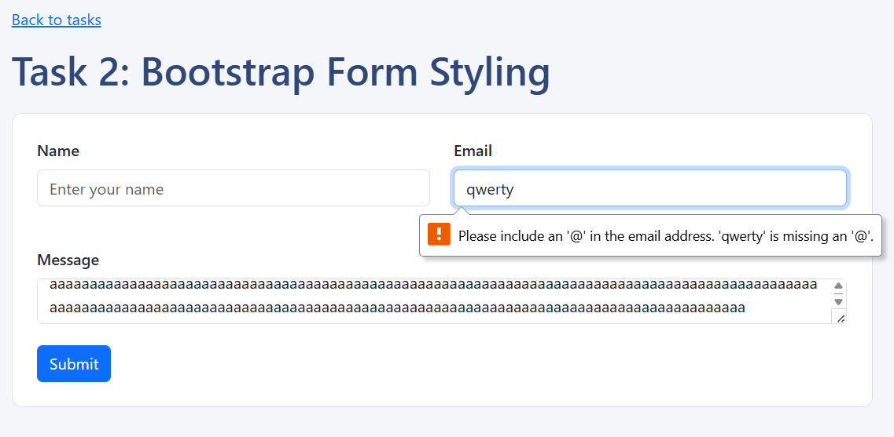
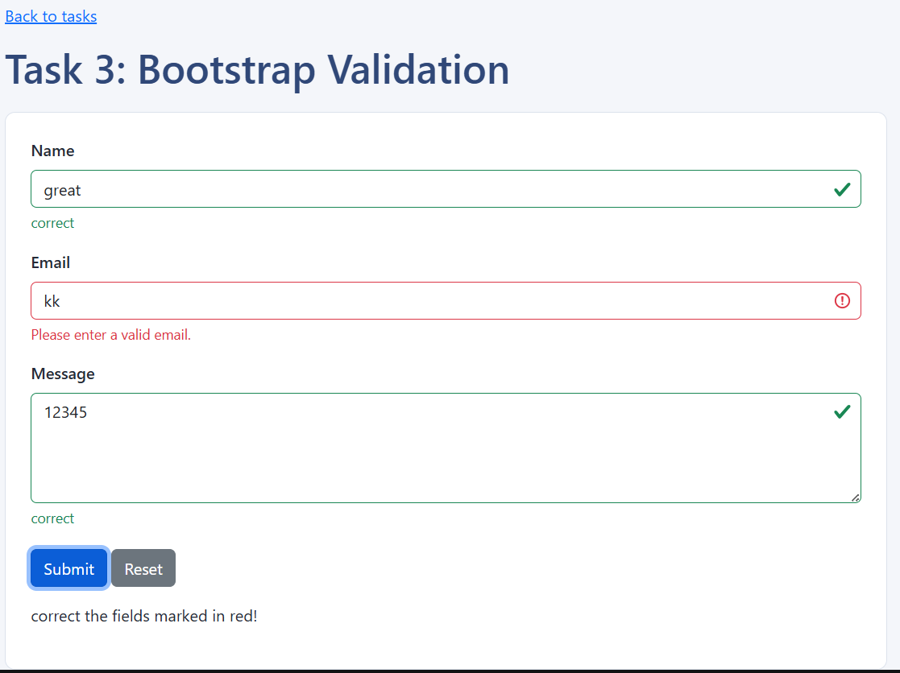
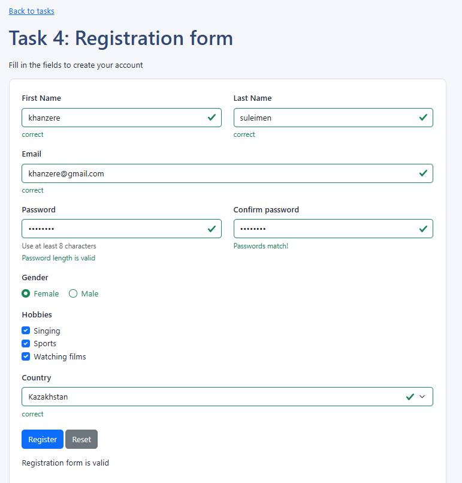
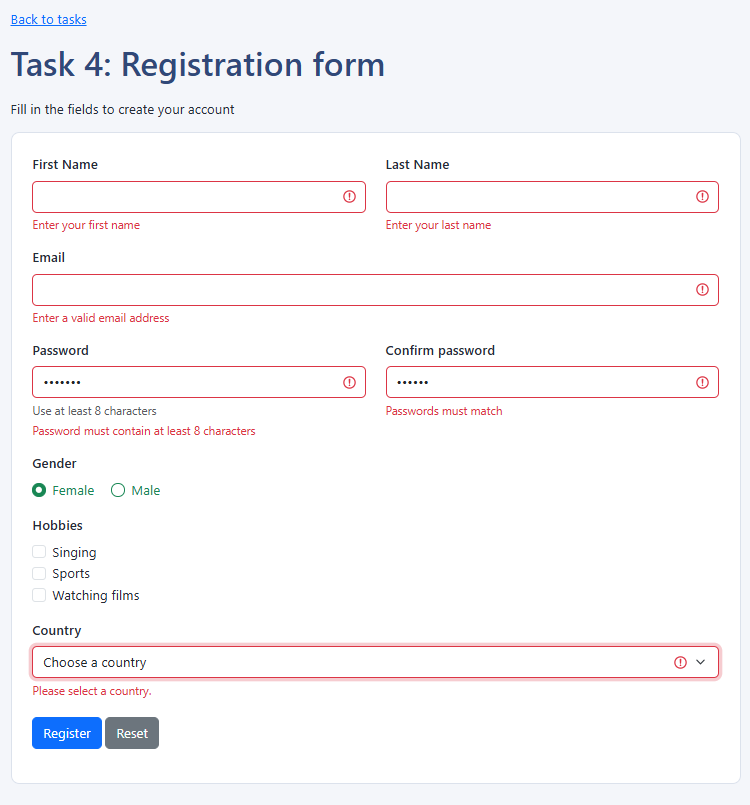

# Assignment 4: Forms and Validation

**Name:** Khanzere Suleimen  
**Group:** IT-2504

## Objective
The goal of this assignment is to create HTML forms, style them with bootstrap, and use HTML5 and bootstrap validation.

## Task 0: Simple contact form
Created a contact form with name, email, message, labels, and submit button.

**Screenshot:**

## Task 1: HTML5 Validation
Added required fields, email validation, and maximum character limits. Tested empty fields and invalid email formats.
**Screenshot:**

## Task 2: Bootstrap form styling
Used Bootstrap form classes, a responsive grid, placeholders, and helper text.

**Screenshot:**

## Task 3: Bootstrap validation
Used is-valid, is-invalid, valid-feedback, and invalid-feedback. Added JavaScript to update the validation states and display messages.

**Screenshot:**

## Task 4: Registration form
Created a responsive registration form with first name, last name, email, password, password confirmation, gender, hobbies, country, register, and reset buttons.
Added HTML5 validation and a password matching check.

**Screenshot:**

## Work summary
I created five form tasks using HTML, CSS, Bootstrap 5.3, and JavaScript. I practiced using form labels and inputs, responsive grid classes, HTML5 validation attributes, and Bootstrap validation feedback. I tested the forms with valid and invalid values and checked the layout on different screen sizes.
